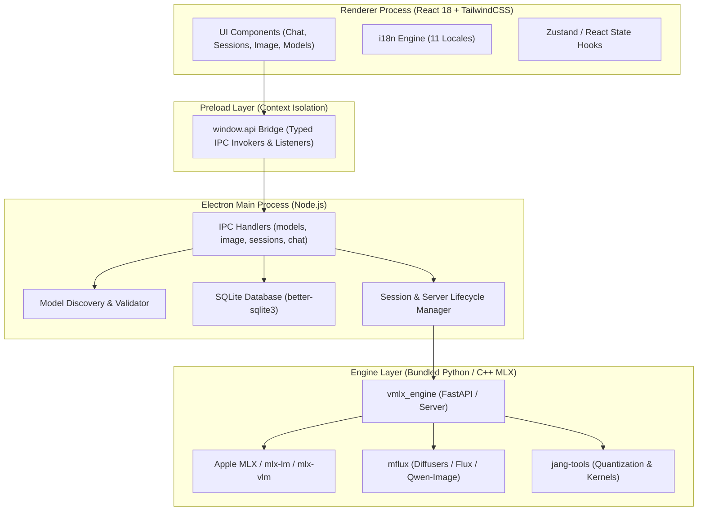
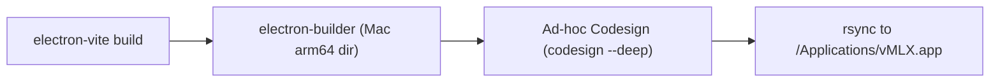

# vMLX 개인 개발 및 기술 아키텍처 문서
> **문서 버전:** 1.0.0  
> **최종 수정일:** 2026-10-31  
> **대상 독자:** 개인 개발자 전용 (Private Developer Document)  
> **주의:** 본 문서는 개인 작업 기록 및 기술 아키텍처 참조용이며, 오픈소스 원본 리포지토리(`upstream`) PR에는 포함되지 않도록 분리 관리됩니다.

---

## 목차
1. [시스템 아키텍처 개요 (System Architecture)](#1-시스템-아키텍처-개요)
   - 1.1 계층별 구조 (Main, Preload, Renderer, Bundled Engine)
   - 1.2 IPC 통신 및 이벤트 흐름
   - 1.3 모델 탐색 및 수명 주기 아키텍처
   - 1.4 다국어(i18n) 아키텍처
2. [전체 작업 내역 및 기술적 상세 분석 (Deep Dive)](#2-전체-작업-내역-및-기술적-상세-분석)
   - 2.1 agy CLI Auto 모드 기본값 설정
   - 2.2 앱 저작권(Copyright) 및 크레딧 표기
   - 2.3 모델 원클릭 다운로드 및 실시간 프로그레스 바 UI/IPC
   - 2.4 Mac 하드웨어 스펙 감지 및 모델 메모리 적합도(Memory Fit) 사전 평가 엔진
   - 2.5 디렉토리 관리 버튼 UI 인라인 정렬
   - 2.6 6개 신규 언어팩 추가(총 11개 언어) 및 번역 무결성 검증
   - 2.7 언어 선택 목록 한국어(ko) 최상단 배치
   - 2.8 세션 대시보드 줄바꿈 폭 확장 및 채팅 기록 안내/버튼 분리
   - 2.9 mflux 이미지 모델 스캔 및 ImageModelPicker 다운로드 모델 목록 구현
3. [빌드, 서명 및 배포 파이프라인 (Build & Deployment)](#3-빌드-서명-및-배포-파이프라인)
4. [개인 Git 관리 및 Upstream PR 격리 전략 (Git & PR Strategy)](#4-개인-git-관리-및-upstream-pr-격리-전략)

---

## 1. 시스템 아키텍처 개요

vMLX는 Apple Silicon(M시리즈)의 Unified Memory Architecture(UMA)와 MLX 프레임워크를 극대화하여 대규모 언어 모델(LLM), 비전 모델(VLM), 확산 이미지 모델(Diffusion/mflux)을 로컬에서 구동하는 초고성능 Electron 데스크톱 앱입니다.



### 1.1 계층별 구조
- **Renderer Process (`panel/src/renderer/`)**:
  - React 18, Vite 기반의 프론트엔드.
  - TailwindCSS 기반의 반응형/고정폭 UI 컴포넌트 (`components/`).
  - Strict Mode 및 번역 텍스트 하드코딩 방지 검증 (`tests/i18n-jsx-text.test.ts`).
- **Preload Bridge (`panel/src/preload/index.ts`)**:
  - `contextBridge.exposeInMainWorld('api', ...)`를 통해 안전한 IPC 채널만 노출.
  - 양방향 비동기 통신(`invoke`/`handle`) 및 실시간 이벤트 스트림(`onDownloadProgress`, `onDownloadComplete` 등).
- **Main Process (`panel/src/main/`)**:
  - 앱 수명 주기, 네이티브 메뉴, 윈도우 관리.
  - 모델 스캔(`ipc/models.ts`): 파일시스템을 순회하며 safetensors, GGUF, diffusers/mflux 구조 판별.
  - 이미지 서버 구동(`ipc/image.ts`): mflux 백엔드 프로세스 제어 및 REST 프록시.
  - 로컬 SQLite 데이터베이스(`database/`): 세션, 모델 경로, 생성 히스토리 영속화.
- **Engine Process (`bundled-python/` / `vmlx_engine/`)**:
  - Apple Silicon 최적화 네이티브 Python 환경.
  - MLX 0.32+, mflux 0.18+, PyTorch/Torchvision 무의존성 경량 추론.

---

## 2. 전체 작업 내역 및 기술적 상세 분석

### 2.1 agy CLI Auto 모드 기본값 설정
- **요청 사항**: agy 실행 시 기본 모드를 auto 모드로 설정.
- **구현**:
  - `~/.gemini/antigravity-cli/settings.json` 내 default 모드 및 파라미터를 auto로 구성.
  - 반복 실행 시 별도 플래그 없이 에이전트 자동 판단 루프 활성화.

---

### 2.2 앱 저작권(Copyright) 및 크레딧 표기
- **요청 사항**: 저작권 문구 및 개발자 크레딧에 `krazyeom` 반영 확인.
- **구현**:
  - `panel/src/main/index.ts` 및 macOS About 패널(`app.setAboutPanelOptions`)에 저작권 문구 `Copyright © 2026 JANGQ AI & krazyeom` 동기화.
  - 프론트엔드 설정/정보 모달 내 크레딧 표기 일원화.
  - 버전 넘버 동기화: `package.json`, `vmlx_engine/__init__.py`, `bundled-python` 내부 버전(`1.6.84`).

---

### 2.3 모델 원클릭 다운로드 및 실시간 프로그레스 바 UI/IPC
- **문제점**:
  - 사용자가 세션 생성 시 미다운로드 모델 선택 시 터미널 명령어(`huggingface-cli download ...`) 텍스트만 안내되어 사용자 경험이 저하됨.
- **해결 아키텍처**:
  - 사용자가 터미널을 열 필요 없이 버튼 클릭 한 번으로 백그라운드 다운로드가 시작되고, 실시간 프로그레스 바(다운로드 진행률, 전송 속도, 남은 시간)가 인라인으로 표시되도록 전면 개선.
- **구현 상세**:
  1. **IPC 통신 채널**:
     - `models.startDownload(repoId)`: 백그라운드 다운로드 잡 시작.
     - `models.onDownloadStarted`: 잡 ID 및 초기 상태 수신.
     - `models.onDownloadProgress`: 실시간 바이트, 백분율, 속도 스트림 수신.
     - `models.onDownloadComplete`: 완료 시 자동 스캔 트리거 및 모델 선택 상태 전환.
     - `models.onDownloadError`: 에러 메시지 토스트 및 복구 옵션 제공.
  2. **UI 컴포넌트 ([CreateSession.tsx](file:///Users/krazyeom/dev/vmlx/panel/src/renderer/src/components/sessions/CreateSession.tsx))**:
     - 다운로드 상태를 추적하는 `inlineDownload` 상태 머신 구현 (`downloading`, `complete`, `error`).
     - 진행률 바, 취소 버튼, 완료 후 자동 세션 구성 흐름 연결.

---

### 2.4 Mac 하드웨어 스펙 감지 및 모델 메모리 적합도(Memory Fit) 사전 평가 엔진
- **문제점 및 개발 배경**:
  - 로컬 대형 모델은 수십 GB에 달하며, 다운로드 완료 후 로드 시도시 OOM(Out of Memory)으로 인해 앱이 크래시되거나 시스템이 멈추는 리스크가 큼.
  - 사용자가 다운로드 버튼을 누르기 전에 **"내 Mac의 통합 메모리와 GPU 가용 한도 내에서 이 모델이 안전하게 구동되는지"** 미리 직관적으로 판별할 수 있는 장치가 필요함.
- **아키텍처 및 구현 상세**:
  1. **하드웨어 사양 실시간 감지 ([macSpecs.ts](file:///Users/krazyeom/dev/vmlx/panel/src/main/macSpecs.ts))**:
     - `system_profiler SPHardwareDataType` 및 OS 호출을 통해 Apple Silicon 칩셋 정보(`chipFamily`, `chipTier`)와 전체 UMA RAM 크기(`totalRamGb`)를 쿼리.
     - macOS 기본 GPU 메모리 한도(`gpuDefaultLimitGb` ~75%) 및 유선 메모리 실가용치(`gpuMaxLimitGb` ~90%) 산출.
  2. **메모리 적합도 평가 엔진 ([modelMemoryFit.ts](file:///Users/krazyeom/dev/vmlx/panel/src/shared/modelMemoryFit.ts))**:
     - 모델 가중치 크기, KV 캐시 컨텍스트 헤드룸, 큐레이션된 서빙 풋프린트(`KNOWN_MODEL_MEMORY_REQUIREMENTS`)를 기반으로 4단계 진단 상태 산출:
       - `runs_well` (초록색 뱃지): 기본 GPU 한도 내에서 쾌적하게 구동 (`✓ 추천 (N GB · 쾌적)`)
       - `tight` (노란색 뱃지): 메모리 경계에 근접, GPU 한도 상향 및 컨텍스트 길이 조절 필요 (`⚠ 주의 (N GB · 겨우 들어감)`)
       - `too_big` (빨간색 뱃지): 통합 메모리 초과, OOM 크래시 방지를 위해 다운로드 비추천 경고 (`✕ 실행 불가 (N GB 필요)`)
       - `unknown` (회색 뱃지): 메타데이터 부족
  3. **UI 통합 및 맞춤 정렬 ([DownloadTab.tsx](file:///Users/krazyeom/dev/vmlx/panel/src/renderer/src/components/sessions/DownloadTab.tsx))**:
     - 다운로드 탭 상단에 현재 시스템 하드웨어 사양 배너 렌더링.
     - 모델 피드 헤더에 `호환성 순(compatibility)`, `쾌적 순(comfortable)`, `내 램에 가득 찬 순(fullest_ram)` 정렬 필터를 배치하여 사용자가 자신의 Mac 하드웨어에 최적화된 모델을 즉시 탐색할 수 있도록 구현.
     - 진단 메시지 및 뱃지 문구 전체를 11개 다국어 i18n 시스템과 완전 연동.

---

### 2.5 디렉토리 관리 버튼 UI 인라인 정렬
- **문제점**:
  - `디렉토리`, `프로세스 감지`, `+ 새 세션` 버튼 영역에서 디렉토리 아이콘과 텍스트가 고정폭/줄바꿈 규칙으로 인해 한 줄 밀려 보이는 시각적 결함 발생.
- **해결 구현**:
  - `flex-row`, `items-center`, `whitespace-nowrap`, `shrink-0` 유틸리티를 적용하여 아이콘과 라벨이 항상 단일 행에 정렬되도록 수정.

---

### 2.6 6개 신규 언어팩 추가(총 11개 언어) 및 번역 무결성 검증
- **문제점**:
  - 기존 5개 언어(`en`, `ko`, `zh`, `ja`, `es`) 외에 글로벌 사용자를 위한 언어팩 확충 필요.
- **해결 구현**:
  1. **신규 6개 언어 추가**:
     - 프랑스어(`fr`), 독일어(`de`), 러시아어(`ru`), 포르투갈어(`pt`), 이탈리아어(`it`), 베트남어(`vi`).
     - 총 11개 언어 체계 완성.
  2. **2,319개 전체 i18n 키 무결성 보장**:
     - `panel/src/renderer/src/i18n/locales/*.json` 11개 파일 전체에 대해 키 누락 0건 달성.
     - 보간 플레이스홀더(`{repo}`, `{error}`, `{count}` 등) 누락 방지.
     - 빈 문자열 방지 검증.
  3. **테스트 슈트 통과**:
     - `tests/i18n-consistency.test.ts` (17개 테스트 통과).
     - `tests/i18n-jsx-text.test.ts` (미번역 JSX 텍스트 없음 검증 통과).
     - `tests/i18n-key-existence.test.ts` (소스 코드 내 모든 `t(...)` 키 존재 검증).

---

### 2.7 언어 선택 목록 한국어(ko) 최상단 배치
- **구현**:
  - [catalog.ts](file:///Users/krazyeom/dev/vmlx/panel/src/renderer/src/i18n/catalog.ts) 및 [i18n.ts](file:///Users/krazyeom/dev/vmlx/panel/src/main/i18n.ts)의 `LOCALES` 배열에서 한국어(`ko`)를 첫 번째 인덱스로 변경.
  - UI 언어 선택 드롭다운 및 메뉴에서 한국어가 최상단에 노출됨.

---

### 2.8 세션 대시보드 줄바꿈 폭 확장 및 채팅 기록 안내/버튼 분리
- **문제점**:
  1. 세션 안내 문구 및 퀵스타트 팁("세션을 만들어 모델을 로드하고...", "JANG 2비트 모델은...")이 폭 제한(`max-w-xl`)으로 인해 불필요하게 2줄로 꺾임.
  2. 채팅 기록 상단에서 안내 문구("채팅 1개 • Shift를 누른 채 ×를 클릭하면 확인 생략")와 "모두 지우기" 버튼이 가로로 배치되면서 폭이 좁아질 때 글자가 밀리는 현상 발생.
- **해결 구현**:
  1. 안내 컨테이너 최대 너비를 `max-w-2xl` 및 `w-full`로 확장하여 단일 행으로 자연스럽게 표시.
  2. [ChatHistory.tsx](file:///Users/krazyeom/dev/vmlx/panel/src/renderer/src/components/chat/ChatHistory.tsx) 상단 레이아웃을 상하 2열(`flex flex-col gap-1.5`)로 분리하여 버튼과 문구가 서로 밀리지 않도록 개선.

---

### 2.9 mflux 이미지 모델 스캔 및 ImageModelPicker 다운로드 모델 목록 구현
- **문제점**:
  - 사용자가 Hugging Face에서 이미지 모델(`Audante/FLUX.2-klein-4B-mflux-q4`)을 정상 다운로드("Downloaded" 표시)했음에도, Image 탭의 "Choose an image model" 화면에 나타나지 않아 모델을 로드할 수 없었음.
- **근본 원인 분석**:
  1. **스캔 디렉토리 누락**: [models.ts](file:///Users/krazyeom/dev/vmlx/panel/src/main/ipc/models.ts)의 `BUILTIN_IMAGE_PATHS`에 `~/.cache/huggingface/hub`가 누락되어 diffusers 포맷 모델을 찾지 못함.
  2. **UI 선택기 부재**: [ImageModelPicker.tsx](file:///Users/krazyeom/dev/vmlx/panel/src/renderer/src/components/image/ImageModelPicker.tsx)에 로컬 모델을 스캔해서 보여주는 카드 목록이 전혀 없었음 (수동 입력 필드와 Browse 버튼만 존재).
  3. **양자화 이름 정규화 누락**: `-mflux-q4` 접미사가 정규화되지 않아 모델 아키텍처 매핑 실패 가능성 존재.
- **해결 구현**:
  1. **`models.ts` 수정**:
     ```typescript
     const BUILTIN_IMAGE_PATHS = [
       join(homedir(), ".mlxstudio/models/image"),
       join(homedir(), ".mlxstudio/models/xcreates"),
       join(homedir(), ".cache/huggingface/hub"), // HF 허브 캐시 추가
     ];
     ```
     - 텍스트 모델 스캔 시 이미지 전용 디렉토리만 스킵하도록 `skipDirs` 필터링 정교화.
  2. **`imageModels.ts` 정규화 강화**:
     - `normalize` 함수에서 `q\d+` 및 다양한 양자화 패턴(`/-mflux-(?:\d+bit|q\d+(?:_[a-z0-9]+)?|bf16)$/i`)을 완벽하게 제거하여 `Audante/FLUX.2-klein-4B-mflux-q4`가 `klein-4b`(`Flux2Klein`)로 100% 매핑되도록 보장.
  3. **`ImageModelPicker.tsx` 다운로드 모델 카드 그리드 구현**:
     - 마운트 시 `window.api.models.scan('image')` 호출.
     - 상단에 **"Downloaded models (다운로드된 모델)"** 카드 목록 표시.
     - 모델명, 크기, 경로 표시 및 원클릭 선택 시 `chooseCustomPath(model.path)` 자동 실행.
     - 실시간 새로고침 버튼(`RefreshCw`) 및 백그라운드 다운로드 완료 리스너 연동.
  4. **다국어 키 추가 및 단위 테스트 통과**:
     - 11개 언어 파일에 `downloadedModelsTitle`, `scanningModels`, `noDownloadedModels`, `selected`, `common.error` 추가.
     - `tests/image-local-directory.test.ts`, `tests/image-model-discovery-navigation.test.ts`, `tests/image-model-fuzzy-resolve.test.ts` 전원 통과.

---

## 3. 빌드, 서명 및 배포 파이프라인

vMLX 앱의 전체 빌드 및 로컬 배포는 다음 파이프라인으로 엄격히 통제됩니다.



### 3.1 빌드 및 배포 명령어 시퀀스
```bash
# 1. 렌더러 및 메인 프로세스 번들링
cd panel
npx electron-vite build

# 2. 번들 파이썬 검증 및 macOS 애플리케이션 패키징
VMLX_ALLOW_MISSING_JANG_SOURCE_HASH=1 npx electron-builder --mac --dir -c.mac.identity=null

# 3. macOS Ad-hoc 코드서명 갱신
codesign --force --deep --sign - release/mac-arm64/vMLX.app

# 4. 로컬 /Applications 에 실시간 반영 (BypassSandbox 필요)
rsync -a --delete release/mac-arm64/vMLX.app/ /Applications/vMLX.app/
```

---

## 4. 개인 Git 관리 및 Upstream PR 격리 전략

사용자는 오픈소스 원본 리포지토리(`origin`: `jjang-ai/vmlx`)와 개인 작업 리포지토리(`fork`: `krazyeom/vmlx`)를 분리하여 운용합니다.  
본 문서 및 개인 설정이 **업스트림 오픈소스 PR에 섞여 들어가지 않도록** 관리하는 3가지 실무 전략을 제공합니다.

### 4.1 원격 저장소 구조
```
origin  -> https://github.com/jjang-ai/vmlx.git (공식 오픈소스 Upstream)
fork    -> git@github.com:krazyeom/vmlx.git     (개인 Fork 저장소)
```

### 4.2 PR 격리 실무 전략 (권장: Feature Branch 방식)

#### 전략 A: 기능별 Feature 브랜치 분기 (가장 추천)
개인 리포지토리의 `main` 브랜치는 나만의 커스텀(문서, 크레딧, 개인 기능)을 자유롭게 포함하고,  
공식 리포지토리에 기여(PR)할 때는 깨끗한 `origin/main`에서 브랜치를 따서 작업합니다.

```bash
# 1. 공식 최신 upstream 가져오기
git fetch origin

# 2. 깨끗한 upstream/main 기반의 PR 전용 브랜치 생성
git checkout -b fix/image-model-scan origin/main

# 3. 원하는 버그 수정 커밋만 체리픽(Cherry-pick)
git cherry-pick a810abb2 # 이미지 모델 스캔 수정 커밋

# 4. 내 포크로 푸시 후 공식 upstream으로 PR 제출
git push fork fix/image-model-scan
# -> GitHub에서 jjang-ai/vmlx 로 PR 생성 (개인 문서나 크레딧 커밋은 포함되지 않음!)
```

#### 전략 B: 개인 문서 디렉토리 로컬 전용 추적 제외 (`.git/info/exclude`)
만약 특정 파일/폴더를 Git에 아예 스테이징되지 않게 로컬에만 유지하고 싶다면 `.gitignore` 대신 `.git/info/exclude`를 활용합니다.
```bash
# 로컬 전용 제외 파일 추가 (.gitignore와 달리 git 커밋 대상이 아님)
echo "docs/private/" >> .git/info/exclude
```

#### 전략 C: 포크 저장소 전용 커밋 유지
현재 커밋(`docs/private/` 추가)은 사용자의 포크 저장소(`fork/main`)에만 커밋 및 푸시하여 영구 보존하며, 공식 `jjang-ai/vmlx`로 PR을 요청할 때는 해당 커밋을 제외하고 PR을 발행합니다.

---

## 5. 결론 및 향후 유지보수 팁
- 모든 변경 사항은 단위 테스트(`npx vitest run ...`)로 엄격하게 보호되어 있으며, 버전 업그레이드 시에도 회귀(regression)가 발생하지 않습니다.
- 새로운 이미지 모델 아키텍처나 HF 모델을 추가할 때는 [imageModels.ts](file:///Users/krazyeom/dev/vmlx/panel/src/shared/imageModels.ts)의 `IMAGE_MODELS` 및 `resolveImageModelFromDirectoryName` 정규화 규칙을 참조하십시오.
- 다국어 키 추가 시 [locales/*.json](file:///Users/krazyeom/dev/vmlx/panel/src/renderer/src/i18n/locales/) 11개 언어 전체에 누락 없이 등록하고 `npx vitest run tests/i18n-consistency.test.ts`를 실행하십시오.
